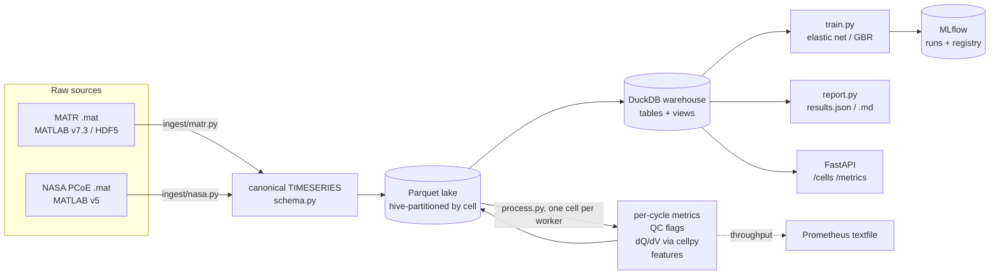

# Battery Cycling Data Pipeline

An ETL pipeline that turns raw battery-cycler time series (current, voltage,
temperature) from public cell-aging datasets into per-cycle metrics, checks
data quality, flags anomalous cells, and benchmarks early-cycle life
prediction against a published result.

> Independent project on public data. Not affiliated with, or endorsed by,
> Toyota Research Institute, MIT, Stanford, NASA, or any battery maker.

- **Ingest** 8.3 GB of MATLAB files (LFP/graphite cells from Severson et al.
  2019, the standard early-life-prediction benchmark) and NASA's PCoE battery
  set into one canonical schema, stored as Parquet and queried through
  DuckDB. Downloads are checksummed.
- **Per-cycle metrics** recomputed from the raw signals: charge/discharge
  capacity by coulomb counting, coulombic and energy efficiency, a DC
  resistance proxy, can-temperature mean/max/min/integral, dQ/dV curves
  (cellpy's incremental-capacity analysis) and ΔQ(V) curves.
- **Data quality**: 11 cycle-level checks (gaps, non-monotonic time,
  out-of-range sensors, temperature spikes, capacity that disagrees with the
  dataset's own summary, ...) and cell-level anomaly detection (robust
  z-scores + isolation forest) with written rejection criteria.
- **Early-cycle life prediction**: the paper's elastic-net models on the
  paper's split, next to the published numbers, plus three pre-registered
  candidate improvements chosen by training-set cross-validation only.
- **Engineering**: pytest unit/integration/end-to-end tests on committed
  real-data fixtures, Docker + docker compose, GitHub Actions CI, MLflow
  tracking and model registry, a FastAPI read API and Prometheus metrics.

## Results

Every number below is produced by `make all` (`bcp all` + `bcp report`) and
pasted in by `scripts/update_readme.py`; none is typed by hand.

<!-- results:start -->
<!-- results:end -->

## Architecture



## Data

| Dataset | What | License / terms | Size |
|---|---|---|---|
| Severson, Attia et al., *Nature Energy* 4, 383–391 (2019), via [data.matr.io](https://data.matr.io/1/projects/5c48dd2bc625d700019f3204) (Toyota Research Institute) | A123 APR18650M1A LFP/graphite cells, 72 fast-charging policies, 30 °C chamber, cycled to 80% of 1.1 Ah; 5 s logging of current, voltage, can temperature | "All data is released under CC BY 4" (data.matr.io); please cite the paper | 3 files, 8.3 GB |
| B. Saha and K. Goebel, "Battery Data Set", NASA Prognostics Data Repository, NASA Ames Research Center (2007) | 34 18650 Li-ion cells (2 Ah rated; chemistry not stated), charge/discharge/impedance at 4–44 °C ambient | U.S. Government work (NASA open data) | 1 zip, 0.2 GB |

`data/manifest.json` lists every file with its URL, byte size and SHA-256;
`scripts/download_data.py` downloads (with resume) and verifies them. Raw and
processed data are git-ignored. `tests/fixtures/` holds small trimmed copies
of real cells (built by `scripts/make_fixture.py`) so tests and CI run
without the 8 GB download.

The cohort, the train / primary-test / secondary-test split and the cell
exclusions follow the authors' published loading code
([rdbraatz/data-driven-prediction-of-battery-cycle-life-before-capacity-degradation](https://github.com/rdbraatz/data-driven-prediction-of-battery-cycle-life-before-capacity-degradation)).
The paper's modelling code is not public; the models here are a
re-implementation from the paper's text.

## Reproduce

```bash
make install        # Python 3.13 venv (cellpy 2.x needs 3.13)
make data           # 8.5 GB download, checksums verified
make all            # ~15 min on an M1 Pro: ingest, metrics, QC, train, report
python scripts/update_readme.py
make test           # unit + integration + end-to-end on the committed fixtures
```

Without the download, on the committed sample:

```bash
docker compose up   # pipeline end to end, then API on :8000 and MLflow UI on :5000
```

## How it works

**Canonical schema** (`schema.py`). Every loader emits the same columns:
`cell_id, cycle_index, step_index, step_type, test_time_s, cycle_time_s,
current_a (+ = charge), voltage_v, temperature_c, charge_capacity_ah,
discharge_capacity_ah`. A loader that drops or invents a column fails
`conform()`. Source quirks are handled in the loader, not downstream: MATR
stores current as a C-rate (× 1.1 Ah to get amperes) and an empty cycle 1;
five batch-1 cells continue in batch 2 and are merged into one history; NASA
stores charge and discharge as separate operations, which become one cycle.

**Per-cycle metrics** (`metrics.py`). Capacities and energies are
integrals of the raw current and power over time, kept next to the dataset's
own numbers so each cycle cross-checks the other. The DC-resistance proxy is
|ΔV/ΔI| across the first sample of the discharge step (it includes one
sampling interval of polarisation; the dataset's pulse IR is reported too).
dQ/dV comes from `cellpy.utils.ica.dqdv`; ΔQ(V) uses the dataset's
1000-point Q(V) interpolation.

**Data quality** (`quality.py`, rules in
[`docs/outlier_criteria.md`](docs/outlier_criteria.md)). Cycle checks run on
every cycle; "bad" cycles (interrupted, non-monotonic time, or a summary
capacity that disagrees with the raw current by > 2%) are dropped before
features are built. Cell-level indicators over cycles 2–100 are scored with
modified z-scores and an isolation forest, per source.

**Life prediction** (`features.py`, `model.py`, protocol in
[`docs/experiments.md`](docs/experiments.md), committed before the first test
score). Target is log10 cycle life; features are the paper's 20 candidates
from cycles 2–100. Every run is logged to MLflow (params, metrics, parity
plot, predictions, model with signature); the best baseline and the selected
candidate are registered as model versions.

**Serving and monitoring.** `uvicorn battery_pipeline.api:app` serves
`/cells`, `/cells/{id}`, `/cells/{id}/cycles` and `/metrics`; every CLI run
writes `pipeline_metrics.prom` (rows, cycles, cells, wall time and rows/s per
stage) in Prometheus textfile format.

## Repository layout

```
src/battery_pipeline/   ingest/ (matr, nasa), schema, steps, metrics, quality, features,
                        cohort, model, process, train, report, store, telemetry, api, cli, sql/views.sql
scripts/                download_data.py, make_fixture.py, update_readme.py
docs/                   outlier_criteria.md, experiments.md
tests/                  unit, integration and end-to-end tests; fixtures/ (trimmed real cells)
reports/                results.json and results.md from the last full run
```

## Limitations

- One cell type dominates: the life-prediction benchmark is LFP/graphite
  A123 cells under fast charging in a 30 °C chamber. Nothing here shows the
  models transfer to other chemistries, formats or field use.
- 41 training cells: the elastic-net coefficients and the CV-based model
  choice are noisy; differences of a few cycles of RMSE are not meaningful.
- The paper's supplementary feature definitions (exact transforms) were not
  available; choices are documented in `features.py`, which may explain part
  of any gap to the published numbers.
- QC thresholds are protocol limits and robust statistics, not tuned on
  labelled faults; the dataset has no ground-truth fault labels, so precision
  and recall of the anomaly flags cannot be measured. The comparison with the
  cells the authors excluded is a sanity check, not a validation.
- The DC-resistance proxy is limited by the 5 s logging interval.
- NASA cells run varied, partly undocumented protocols; they are used for the
  ETL, metrics and QC, not for the life-prediction benchmark.

## License

Code: MIT (see `LICENSE`). Data: not redistributed except the small trimmed
fixtures in `tests/fixtures/` (MATR: CC BY 4.0, Severson et al. 2019,
data.matr.io; NASA: U.S. Government work, Saha & Goebel 2007).
