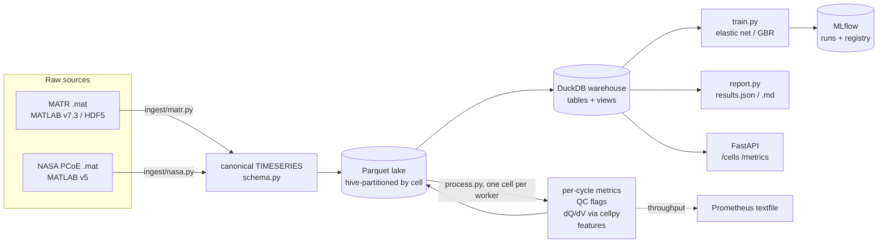

# Battery Cycling Data Pipeline

An ETL pipeline that turns raw battery-cycler time series (current, voltage,
temperature) from public cell-aging datasets into per-cycle metrics, checks
data quality, flags anomalous cells, and benchmarks early-cycle life
prediction against a published result.

> Independent project on public data. Not affiliated with, or endorsed by,
> Toyota Research Institute, MIT, Stanford, NASA, or any battery maker.

- **Ingest** 8.3 GB of MATLAB files (LFP/graphite cells from Severson et al.
  2019, the standard early-life-prediction benchmark) and NASA's PCoE battery
  set into one canonical schema, stored as Parquet and queried through
  DuckDB. Downloads are checksummed.
- **Per-cycle metrics** recomputed from the raw signals: charge/discharge
  capacity by coulomb counting, coulombic and energy efficiency, a DC
  resistance proxy, can-temperature mean/max/min/integral, dQ/dV curves
  (cellpy's incremental-capacity analysis) and ΔQ(V) curves.
- **Data quality**: 11 cycle-level checks (gaps, non-monotonic time,
  out-of-range sensors, temperature spikes, capacity that disagrees with the
  dataset's own summary, ...) and cell-level anomaly detection (robust
  z-scores + isolation forest) with written rejection criteria.
- **Early-cycle life prediction**: the paper's elastic-net models on the
  paper's split, next to the published numbers, plus three pre-registered
  candidate improvements chosen by training-set cross-validation only.
- **Engineering**: pytest unit/integration/end-to-end tests on committed
  real-data fixtures, Docker + docker compose, GitHub Actions CI, MLflow
  tracking and model registry, a FastAPI read API and Prometheus metrics.

## Results

Every number below is produced by `make all` (`bcp all` + `bcp report`) and
pasted in by `scripts/update_readme.py`; none is typed by hand.

<!-- results:start -->
<!-- generated by `bcp report`; do not edit by hand -->
### Data

- 169 cells (135 MATR after merging the five continued cells, 34 NASA), 117,527 cycles with data, 119,151,684 time-series rows (3.24 GB Parquet + 0.93 GB Q(V) curves).
- Paper cohort: 41 train / 43 primary test / 40 secondary test.

### Per-cycle metrics vs. the dataset's own summary

- Discharge capacity from coulomb counting vs. dataset value over 117,439 cycles: median |diff| 0.58 mAh, 99th percentile 46.6 mAh, 70.9% of cycles within 1%.
- Median coulombic efficiency 0.9998, median energy efficiency 0.865.
- Median DCIR proxy 19.6 mΩ vs. dataset pulse IR 16.5 mΩ (MATR).

| Group | Cells | Cycles | Coulomb counting vs. dataset capacity, median (p10–p90) | Cycles a fixed 2% rule would flag | Bad cycles (offset-relative rule) | Median CE |
|---|---:|---:|---|---:|---:|---:|
| b1 | 46 | 42,158 | +0.04% (+0.03% to +0.05%) | 0.1% | 4.1% | 0.9991 |
| b2 | 43 | 21,527 | +0.04% (+0.04% to +0.05%) | 0.1% | 2.9% | 0.9984 |
| b3 | 46 | 51,007 | +1.66% (+0.30% to +3.64%) | 43.7% | 0.2% | 1.0053 |
| nasa | 34 | 2,835 | +2.06% (+0.22% to +23.71%) | 48.9% | 31.4% | 0.9964 |

### Data quality

| Cycle check | MATR cycles flagged | NASA cycles flagged |
|---|---:|---:|
| `empty_cycle` | 46 | 3 |
| `duplicate_cycle` | 0 | 0 |
| `time_gap` | 2,566 | 165 |
| `time_not_monotonic` | 223 | 0 |
| `voltage_out_of_range` | 17 | 225 |
| `current_out_of_range` | 3 | 0 |
| `temperature_missing` | 0 | 0 |
| `temperature_out_of_range` | 0 | 0 |
| `temperature_spike` | 284 | 9 |
| `capacity_mismatch` | 157 | 698 |
| `ce_out_of_range` | 2,106 | 471 |

| Cell-level result | MATR | NASA |
|---|---|---|
| Degradation outliers (early fade, \|z\| > 3.5) | 15: b1c20, b1c21, b2c0, b2c1, b2c12, b2c13, b2c18, b2c19, b2c23, b2c3, b2c4, b2c6, b3c21, b3c28, b3c6 | 2: nasa_B0040, nasa_B0051 |
| Measurement anomalies (temperature, IR, CE, sensor, isolation forest) | 11: b1c3, b1c31, b1c4, b2c0, b2c1, b2c25, b2c36, b3c17, b3c28, b3c29, b3c6 | 4: nasa_B0034, nasa_B0040, nasa_B0042, nasa_B0050 |

- Cycle life: our end-of-life rule reproduces the dataset's reported cycle life exactly for 128 of 128 MATR cells (max difference 0 cycles).
- Of the 5 batch-1 cells the authors dropped for not reaching 80%, our rule finds 5 (7 MATR cells in total never reach 80%).
- Of the 6 batch-3 cells the authors' loader drops as noisy, 2 never reached 80% (b3c23, b3c32); the cell-level rules flag 0 of the six.

### Early-cycle life prediction (paper split)

RMSE in cycles; mean % error in brackets. *Primary test excl.* drops the one primary-test cell that reaches 80% fastest (`b2c1`), as the paper's parenthetical numbers do.

| Model | Train | Primary test | Primary test excl. | Secondary test | Train CV RMSE |
|---|---:|---:|---:|---:|---:|
| variance | 103 (14.1%) | 138 (14.7%) | 139 (13.2%) | 196 (11.4%) | 117 |
| ↳ paper | 103 (14.1%) | 138 (14.7%) | 138 (13.2%) | 196 (11.4%) | |
| discharge | 70 (9.4%) | 86 (12.7%) | 80 (9.5%) | 169 (8.6%) | 95 |
| ↳ paper | 76 (9.8%) | 91 (13.0%) | 86 (10.1%) | 173 (8.6%) | |
| full | 60 (6.3%) | 158 (12.8%) | 156 (9.8%) | 213 (10.7%) | 97 |
| ↳ paper | 51 (5.6%) | 118 (14.1%) | 100 (7.5%) | 214 (10.7%) | |
| gbr_candidates | 3 (0.3%) | 117 (11.0%) | 114 (8.3%) | 311 (17.6%) | 177 |
| enet_candidates_temp | 35 (3.9%) | 232 (17.3%) | 224 (10.4%) | 252 (22.4%) | 108 |
| enet_discharge_ica | 61 (8.2%) | 94 (11.3%) | 90 (8.3%) | 163 (10.7%) | 95 |
| variance_noqc | 104 (14.1%) | 138 (14.8%) | 138 (13.2%) | 196 (11.4%) | 117 |
| ↳ paper | 103 (14.1%) | 138 (14.7%) | 138 (13.2%) | 196 (11.4%) | |
| discharge_noqc | 69 (9.3%) | 311 (16.6%) | 312 (13.4%) | 168 (9.7%) | 96 |
| ↳ paper | 76 (9.8%) | 91 (13.0%) | 86 (10.1%) | 173 (8.6%) | |
| full_noqc | 56 (6.1%) | 161 (12.8%) | 160 (9.9%) | 194 (11.5%) | 92 |
| ↳ paper | 51 (5.6%) | 118 (14.1%) | 100 (7.5%) | 214 (10.7%) | |

Candidate chosen by training-set CV only: **enet_discharge_ica** (best baseline by the same CV: discharge).

**What the table says**

- `variance`: largest RMSE gap to the paper is +1 cycle (primary test excl.) with QC cleaning and +1 cycle (train) without.
- `discharge`: largest RMSE gap to the paper is -6 cycles (train) with QC cleaning and +226 cycles (primary test excl.) without.
- `full`: largest RMSE gap to the paper is +56 cycles (primary test excl.) with QC cleaning and +60 cycles (primary test excl.) without.
- QC cleaning matters most for `discharge` on the primary test set (86 vs. 311 cycles). Most of the difference is one cell, `b1c0` (observed 1852 cycles): predicted under 1 cycle from uncleaned features and 2064 cycles after its broken early cycle(s) are dropped (cycle 12: dataset capacity 1.54 Ah, coulomb-counted 3.18 Ah over 10.7 h).
- Selected candidate `enet_discharge_ica` vs. best baseline `discharge`: primary test excl. 90 vs. 80 (+9); secondary test 163 vs. 169 (-6). It does not beat the baseline on both test sets.
- `full` is scored on 41/43/40 train/primary/secondary cells; the paper dropped 4 cells from its full model because temperature probes lost contact, and our temperature checks do not single those out.
<!-- results:end -->

## Architecture



## Data

| Dataset | What | License / terms | Size |
|---|---|---|---|
| Severson, Attia et al., *Nature Energy* 4, 383–391 (2019), via [data.matr.io](https://data.matr.io/1/projects/5c48dd2bc625d700019f3204) (Toyota Research Institute) | A123 APR18650M1A LFP/graphite cells, 72 fast-charging policies, 30 °C chamber, cycled to 80% of 1.1 Ah; 5 s logging of current, voltage, can temperature | "All data is released under CC BY 4" (data.matr.io); please cite the paper | 3 files, 8.3 GB |
| B. Saha and K. Goebel, "Battery Data Set", NASA Prognostics Data Repository, NASA Ames Research Center (2007) | 34 18650 Li-ion cells (2 Ah rated; chemistry not stated), charge/discharge/impedance at 4–44 °C ambient | U.S. Government work (NASA open data) | 1 zip, 0.2 GB |

`data/manifest.json` lists every file with its URL, byte size and SHA-256;
`scripts/download_data.py` downloads (with resume) and verifies them. Raw and
processed data are git-ignored. `tests/fixtures/` holds small trimmed copies
of real cells (built by `scripts/make_fixture.py`) so tests and CI run
without the 8 GB download.

The cohort, the train / primary-test / secondary-test split and the cell
exclusions follow the authors' published loading code
([rdbraatz/data-driven-prediction-of-battery-cycle-life-before-capacity-degradation](https://github.com/rdbraatz/data-driven-prediction-of-battery-cycle-life-before-capacity-degradation)).
The paper's modelling code is not public; the models here are a
re-implementation from the paper's text.

## Reproduce

```bash
make install        # Python 3.13 venv (cellpy 2.x needs 3.13)
make data           # 8.5 GB download, checksums verified
make all            # ingest, metrics, QC, train, report: 503 s (8.4 min) on an Apple M1 Pro
python scripts/update_readme.py
make test           # unit + integration + end-to-end on the committed fixtures
```

Without the download, on the committed sample:

```bash
docker compose up   # pipeline end to end, then API on :8000 and MLflow UI on :5000
```

## How it works

**Canonical schema** (`schema.py`). Every loader emits the same columns:
`cell_id, cycle_index, step_index, step_type, test_time_s, cycle_time_s,
current_a (+ = charge), voltage_v, temperature_c, charge_capacity_ah,
discharge_capacity_ah`. A loader that drops or invents a column fails
`conform()`. Source quirks are handled in the loader, not downstream: MATR
stores current as a C-rate (× 1.1 Ah to get amperes) and an empty cycle 1;
five batch-1 cells continue in batch 2 and are merged into one history; NASA
stores charge and discharge as separate operations, which become one cycle.

**Per-cycle metrics** (`metrics.py`). Capacities and energies are
integrals of the raw current and power over time, kept next to the dataset's
own numbers so each cycle cross-checks the other. The DC-resistance proxy is
|ΔV/ΔI| across the first sample of the discharge step (it includes one
sampling interval of polarisation; the dataset's pulse IR is reported too).
dQ/dV comes from `cellpy.utils.ica.dqdv`; ΔQ(V) uses the dataset's
1000-point Q(V) interpolation.

**Data quality** (`quality.py`, rules in
[`docs/outlier_criteria.md`](docs/outlier_criteria.md)). Cycle checks run on
every cycle; "bad" cycles (interrupted, non-monotonic time, or a summary
capacity that disagrees with the raw current by > 2%) are dropped before
features are built. Cell-level indicators over cycles 2–100 are scored with
modified z-scores and an isolation forest, per source.

**Life prediction** (`features.py`, `model.py`, protocol in
[`docs/experiments.md`](docs/experiments.md), committed before the first test
score). Target is log10 cycle life; features are the paper's 20 candidates
from cycles 2–100. Every run is logged to MLflow (params, metrics, parity
plot, predictions, model with signature); the best baseline and the selected
candidate are registered as model versions.

**Serving and monitoring.** `uvicorn battery_pipeline.api:app` serves
`/cells`, `/cells/{id}`, `/cells/{id}/cycles` and `/metrics`; every CLI run
writes `pipeline_metrics.prom` (rows, cycles, cells, wall time and rows/s per
stage) in Prometheus textfile format; a run of only some stages keeps the
other stages' last values.

## Repository layout

```
src/battery_pipeline/   ingest/ (matr, nasa), schema, steps, metrics, quality, features,
                        cohort, model, process, train, report, store, telemetry, api, cli, sql/views.sql
scripts/                download_data.py, make_fixture.py, update_readme.py
docs/                   outlier_criteria.md, experiments.md
tests/                  unit, integration and end-to-end tests; fixtures/ (trimmed real cells)
reports/                results.json and results.md from the last full run
```

## Limitations

- One cell type dominates: the life-prediction benchmark is LFP/graphite
  A123 cells under fast charging in a 30 °C chamber. Nothing here shows the
  models transfer to other chemistries, formats or field use.
- 41 training cells: the elastic-net coefficients and the CV-based model
  choice are noisy; differences of a few cycles of RMSE are not meaningful.
- The paper's supplementary feature definitions (exact transforms) were not
  available; choices are documented in `features.py`, which may explain part
  of any gap to the published numbers.
- QC thresholds are protocol limits and robust statistics, not tuned on
  labelled faults; the dataset has no ground-truth fault labels, so precision
  and recall of the anomaly flags cannot be measured. The comparison with the
  cells the authors excluded is a sanity check, not a validation.
- The DC-resistance proxy is limited by the 5 s logging interval.
- NASA cells run varied, partly undocumented protocols; they are used for the
  ETL, metrics and QC, not for the life-prediction benchmark.

## License

Code: MIT (see `LICENSE`). Data: not redistributed except the small trimmed
fixtures in `tests/fixtures/` (MATR: CC BY 4.0, Severson et al. 2019,
data.matr.io; NASA: U.S. Government work, Saha & Goebel 2007).
